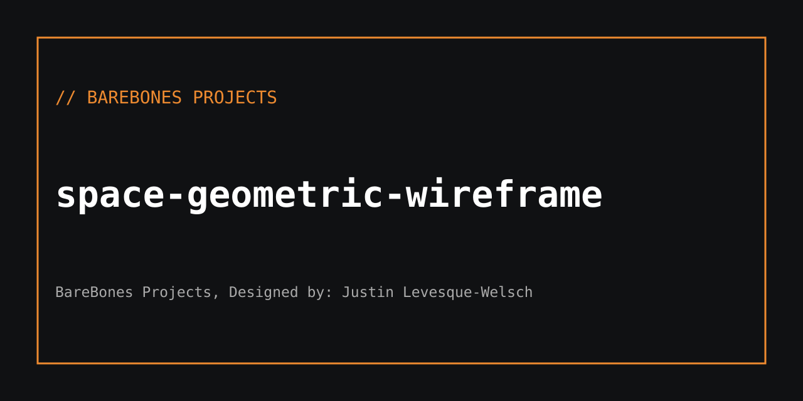

<!-- BareBones Project | Project documentation -->
# space-geometric-wireframe

**BareBones Project**  
**Repository:** [BareBones-Projects/space-geometric-wireframe](https://github.com/BareBones-Projects/space-geometric-wireframe)  
**Copyright:** © 2026 BareBones Project  
**License:** MIT

## Overview

A standalone, interactive animated geometric wireframe visualization. The artwork displays a four-dimensional hypercube (tesseract) projected onto a two-dimensional HTML Canvas. It rotates continuously, giving the effect of a glowing geometric object suspended in a dark spatial environment.

The project runs directly in a modern desktop or mobile browser. All drawing, motion, and interaction are implemented in the included HTML, CSS, and JavaScript. No framework, external script, account, build process, or remote asset is required.

## Visual design

- Luminous cyan wireframe with softly glowing vertices.
- Dark background with a subtle spatial grid and radial lighting.
- Continuous multi-axis rotation and perspective projection.
- Fixed, responsive full-window canvas.
- Minimalist overlay and **BareBones Project** signature.

## Controls

| Control | Function |
| --- | --- |
| Drag the canvas | Adjust viewing angle using mouse, pen, or touch |
| **PAUSE / RESUME** | Stop or resume automatic rotation |
| **SPEED** | Set animation speed between 0× and 3× |
| **RESET** | Restore the starting orientation, time, and 1× speed |

## How the code works

1. **Geometry:** The program creates 16 vertices from every combination of four coordinates set to +1 or −1. It connects vertices that differ in exactly one coordinate, producing the tesseract's 32 edges.
2. **Rotation:** Four independent plane rotations animate the shape in four-dimensional space.
3. **Projection:** A perspective transform compresses the fourth coordinate into 3D, then transforms the 3D points into 2D screen positions.
4. **Rendering:** HTML Canvas draws the background, fine grid, glowing edges, and illuminated vertex points on every animation frame.
5. **Interaction:** Pointer movement changes the orientation. A pause button, speed slider, and reset button update the animation state.
6. **Responsiveness:** The canvas is resized to the viewport and scales with the device's pixel ratio, capped for rendering performance.

## Run

Download the repository and open `index.html` in a modern browser.

Alternatively, from the repository root, serve it locally:

```bash
python -m http.server 8000
```

Then open `http://localhost:8000`.

## Project files

| File | Purpose |
| --- | --- |
| `index.html` | Complete animation, visual styling, and interaction |
| `README.md` | Project overview, controls, technical notes, and usage |
| `LICENSE` | MIT license and BareBones Project copyright notice |
| `.github/workflows/tests.yml` | Automated checks on pushes and pull requests |
| `tests/test_static.py` | Geometry, project branding, and source validation |
| `tests/browser_smoke.py` | Browser checks for rendering, interactions, and responsive behavior |
| `.gitignore` | Excludes local test caches and generated files |

## Testing

Run the built-in static test suite:

```bash
python -m unittest discover -s tests -p 'test_*.py' -v
```

To run the interactive browser test:

```bash
python -m pip install playwright
python -m playwright install chromium
python tests/browser_smoke.py
```

The GitHub Actions workflow runs static tests and a headless browser smoke test when changes are pushed or a pull request is opened. Local Chromium availability is required only for the browser smoke test.

## Maintainer

**BareBones Project**  
GitHub organization: [BareBones-Projects](https://github.com/BareBones-Projects)  
Project: [space-geometric-wireframe](https://github.com/BareBones-Projects/space-geometric-wireframe)

© 2026 BareBones Project. See [LICENSE](LICENSE) for the terms.


---
BareBones Projects, Designed by: Justin Levesque-Welsch
